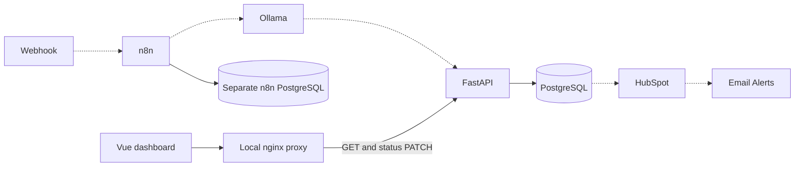

# AI Business Automation Hub

A local customer inquiry workspace: Python 3.12, FastAPI, SQLAlchemy 2,
PostgreSQL, Alembic, n8n, Ollama, and a Vue 3 + TypeScript dashboard. The dashboard
reads real inquiries and aggregate statistics and manages their status lifecycle.
It displays supplied classification fields; it does not generate AI summaries or
modify workflows or integration credentials.

## Architecture and technology



Solid dashboard/API/database connections are implemented. Dashed arrows represent
the **target automation pipeline**, not verified integrations. n8n would orchestrate
the model, persistence, CRM, and alert calls; PostgreSQL does not directly call
HubSpot, nor does Ollama directly POST to FastAPI. The repository contains no
workflow export, model prompt, HubSpot client, or email sender. Existing runtime
workflows are preserved and were not audited or modified in this phase.
See [ARCHITECTURE.md](docs/ARCHITECTURE.md) for the implemented request path and
integration boundaries, and [PORTFOLIO.md](docs/PORTFOLIO.md) for an English project
description ready for a portfolio or project presentation.

| Layer | Stack |
| --- | --- |
| Backend | Python 3.12, FastAPI, Pydantic, SQLAlchemy 2, psycopg |
| Storage | PostgreSQL 17, Alembic |
| Dashboard | Vue 3 Composition API, TypeScript, Vite, Vue Router, Pinia |
| Local automation infrastructure | n8n, Ollama; workflows/models supplied separately |
| Runtime | Docker Compose, unprivileged nginx frontend and Python application user |
| Quality | pytest, Ruff, Vitest, ESLint, vue-tsc, Playwright with Chrome |

## Phase 7 dashboard and inquiry management

- **Overview:** total, high-priority, sales, and support cards; category distribution;
  status counts; five most recent inquiries. Metrics cover the entire database.
- **Inquiries:** server-side search, category/priority/status filters, pagination,
  and customer/date/priority sorting. Filters and selected inquiry are bookmarkable
  in the URL. Searches are debounced; superseded responses cannot replace newer data.
- **Detail panel:** customer, message, AI summary, classification, status, and the
  recorded creation timestamp, displayed in the browser's local timezone. Native
  modal focus handling, Escape-to-close, keyboard-scrollable tables, mobile menu
  focus handling, and announced save feedback support keyboard use.
- Responsive dark UI with loading, empty, error/retry states, local fonts, and no
  production mock data. Status controls support **Start progress**, **Mark resolved**,
  and **Reopen inquiry**, with pending, success, and recoverable error feedback.
- **AI Insights:** stored category, priority, summary, and truthful availability
  information. Missing categories are clearly identified as unclassified and
  legacy-compatible. No confidence, model identity, or processing time is invented.

For an **existing stack already at revision 0002**, run from the repository root:

```powershell
docker compose exec api alembic current
docker compose build api frontend
docker compose up -d --no-deps --wait --wait-timeout 90 api frontend
```

This recreates only the API and frontend, preserving the databases and n8n. No new
migration is introduced by Phase 7. If an older installation is below `0002`, apply
the existing committed migrations using the migration instructions below before
starting the updated API. Do not overwrite an existing `.env` or reset volumes.

Open **http://127.0.0.1:8080** (overview) or
**http://127.0.0.1:8080/inquiries**. The frontend container uses an unprivileged nginx
server with SPA history fallback, security headers, health checks, and a restricted
`/api-proxy` reverse proxy to `api:8000`. It allows reads and only the status PATCH
resource for writes. Browser requests stay on the same origin.
The Docker host binding is strictly `127.0.0.1:8080`.

For frontend development, keep the API running in Docker and use a second PowerShell
terminal (Node 22.12+ and npm required):

```powershell
Set-Location frontend
Copy-Item .env.example .env.local # first setup only
npm.cmd ci
npm.cmd run dev
```

Open **http://127.0.0.1:5173**. `npm.cmd` avoids PowerShell execution-policy errors
from `npm.ps1`. Vite dev and preview servers bind to `127.0.0.1` with fixed ports.
Stop Vite with Ctrl+C. The environment options are:

| Variable | Where | Default / purpose |
| --- | --- | --- |
| `VITE_API_BASE_URL` | `frontend/.env.local`, build time | `http://127.0.0.1:8000` for local dev; Compose builds with `/api-proxy` |
| `CORS_ORIGINS` | root `.env`, API runtime | JSON array `["http://127.0.0.1:5173","http://localhost:5173"]` |
| `E2E_BASE_URL` | test shell | `http://127.0.0.1:8080` for browser checks |

Only explicit HTTP(S) CORS origins are allowed; wildcards are rejected. Use `[]`
to disable cross-origin browser access when only the same-origin Docker dashboard
is used. Changes require recreating the API container. CORS allows GET/PATCH requests
and JSON bodies without credentials; server-to-server n8n requests are unaffected. Browser-visible
`VITE_*` variables must never contain secrets. Changing Vite variables requires a
dev-server restart or a new frontend build. The Docker nginx CSP deliberately
limits connections to the same origin, so keep its API base as `/api-proxy`.

The dashboard and inquiry API have **no application authentication**. Localhost
binding is the access boundary for this phase. Do not change it to `0.0.0.0`, expose
it through a tunnel, or put it on a public host without adding authentication and
authorization at the dashboard and API boundary first. CORS is not authentication.

Frontend verification, from `frontend/`:

```powershell
npm.cmd run typecheck
npm.cmd run lint
npm.cmd test
npm.cmd run build
npm.cmd run test:e2e
```

Browser checks require installed Google Chrome and the running Compose dashboard.
Live checks read the real API without writing data; test-only intercepted responses
exercise filtering, pagination, loading, errors, status progression, conflicts,
reopening, and legacy AI Insights. **All browser status writes are intercepted**
and never reach the application database. With an empty database the live detail
check is explicitly skipped. Unit tests exercise API errors, query parsing,
request cancellation, status actions, and stored AI evidence. Test output is ignored by Git.

Implementation follows the [Vue TypeScript guidance](https://vuejs.org/guide/typescript/composition-api),
[Vite local server options](https://vite.dev/config/server-options), and
[FastAPI CORS guidance](https://fastapi.tiangolo.com/tutorial/cors/).

## Run on Windows (PowerShell)

Install Docker Desktop with the WSL 2 backend, switch to Linux containers, and
start Docker Desktop. Run these commands from the repository root:

```powershell
Copy-Item .env.example .env

# Generate three independent secrets without printing them.
function New-RandomSecret {
    $bytes = New-Object byte[] 32
    $rng = [System.Security.Cryptography.RandomNumberGenerator]::Create()
    try { $rng.GetBytes($bytes) } finally { $rng.Dispose() }
    return ([System.BitConverter]::ToString($bytes)).Replace('-', '').ToLowerInvariant()
}
$content = Get-Content .env -Raw
$content = $content.Replace('replace-with-random-app-password', (New-RandomSecret))
$content = $content.Replace('replace-with-different-random-n8n-password', (New-RandomSecret))
$content = $content.Replace('replace-with-random-64-character-hex-key', (New-RandomSecret))
[System.IO.File]::WriteAllText((Join-Path $PWD '.env'), $content)
Remove-Variable content

docker compose config --quiet
docker compose up --build -d --wait --wait-timeout 180
docker compose ps -a
Invoke-RestMethod http://127.0.0.1:8000/health
```

Copy `.env.example` only on first setup; do not overwrite existing credentials.
The first build pulls images and Python dependencies and requires internet access.
The one-shot `migrate` service must exit with code 0 before the API starts.

- API documentation: http://127.0.0.1:8000/docs
- n8n editor: http://127.0.0.1:5678 (complete its initial owner-account setup)
- From the n8n container, the API is `http://api:8000`, **not** localhost.
- Ollama is available to containers at `http://ollama:11434`; this repository does not download models.

Create and read an inquiry:

```powershell
$body = @{
    customer_name = 'Ada Lovelace'
    email = 'ada@example.com'
    message = 'Please tell me about your services.'
} | ConvertTo-Json
$inquiry = Invoke-RestMethod -Method Post -Uri http://127.0.0.1:8000/api/v1/inquiries -ContentType 'application/json' -Body $body
Invoke-RestMethod "http://127.0.0.1:8000/api/v1/inquiries/$($inquiry.id)"
Invoke-RestMethod 'http://127.0.0.1:8000/api/v1/inquiries?limit=20&offset=0'

# Verify Docker-network reachability without creating a workflow.
docker compose exec n8n node -e "fetch('http://api:8000/health').then(async r => { console.log(await r.text()); process.exit(r.ok ? 0 : 1); }).catch(e => { console.error(e); process.exit(1); })"
```

## API contract

| Method | Path | Result |
| --- | --- | --- |
| GET | `/health` | 200 when the database answers `SELECT 1`; otherwise 503 |
| POST | `/api/v1/inquiries` | Validate and persist an inquiry; 201 |
| GET | `/api/v1/inquiries` | Newest first, with `limit` (1–100) and `offset` (0+) |
| GET | `/api/v1/inquiries/page` | Paginated envelope: `items`, filtered `total`, `limit`, `offset` |
| GET | `/api/v1/inquiries/stats` | Global `total`, `high_priority`, `sales`, `support`, `other`, `unclassified`, `new`, `in_progress`, `resolved` counts |
| GET | `/api/v1/inquiries/{id}` | Retrieve a UUID inquiry, or 404 |
| PATCH | `/api/v1/inquiries/{id}/status` | Validated status change; returns the complete updated inquiry |

Both list endpoints accept `search` (up to 200 characters, case-insensitive literal
substring across name, email, message, and summary), `category` (sales/support/other/
unclassified), `priority` (low/medium/high), `status` (new/in_progress/resolved),
`sort_by` (created_at/customer_name/priority), and `sort_dir` (asc/desc). Defaults
remain newest first, limit 20, offset 0. Ties use UUID descending for stable ordering.
Priority sort uses low < medium < high rather than alphabetic order. Filters combine
with AND; `%` and `_` in search are literal characters. Invalid values return 422.
The original list response remains a JSON array and POST remains unchanged.

Status update JSON:

```json
{"status": "in_progress", "expected_status": "new"}
```

Allowed transitions are `new → in_progress → resolved`, plus
`resolved → in_progress` for reopening. A request for the current state is a 200
no-op. `expected_status` is optional for API callers and always sent by the dashboard.
A stale expectation or forbidden transition returns 409, invalid fields/values 422,
and a missing inquiry 404. A conditional UPDATE also guards against a concurrent
change after the initial read. No modification timestamp or status history is stored.
The UI waits for a successful response, refreshes list/stats, and preserves an open
detail panel even if the inquiry no longer matches its filter. After a conflict or
unknown network outcome, reload before retrying; writes are never automatically retried.

```powershell
Invoke-RestMethod 'http://127.0.0.1:8000/api/v1/inquiries/page?limit=20&offset=0&category=support&priority=high&sort_by=created_at&sort_dir=desc'
Invoke-RestMethod 'http://127.0.0.1:8000/api/v1/inquiries/stats'
```

Search and aggregates are computed in the database, never from a limited frontend
page. Offset pagination and substring searches are appropriate for this local
portfolio stack; large deployments should benchmark these queries and add search
indexes/cursor pagination as needed. A changing inbox can shift offset page boundaries.

Creation requires `customer_name`, `email`, and `message`. Names and messages
are trimmed and cannot be blank; limits are 200 and 10,000 characters. Email is
validated and limited to 254 characters. Unknown fields return 422. The server
assigns a UUID, a UTC timestamp, and `status=new`. Optional classification fields
are `category` (`sales`, `support`, `other`, or null), `priority` (`low`, `medium`,
`high`; default `medium`; null is rejected), and `ai_summary` (a string or null).
Summaries are trimmed, cannot be blank, and have a 10,000-character limit.
Omitted category and summary default to null. For example:

```json
{
  "customer_name": "Ada Lovelace",
  "email": "ada@example.com",
  "message": "Please tell me about your services.",
  "category": "sales",
  "priority": "medium",
  "ai_summary": "Customer requests information about services."
}
```

The original three-field payload remains valid. Migration `0002` changes the
database priority default and constraint, mapping `normal` to `medium` and `urgent`
to `high`. Downgrade maps `medium` back to `normal`; previous `urgent` values cannot
be recovered from `high`. Apply migrations before running the updated API.

## AI classification and priority routing

The implemented API **validates and stores** classification supplied by a caller.
It does not call Ollama itself. In the target pipeline, n8n would submit the original
customer message to Ollama, validate structured JSON, and POST the original fields
plus `category`, `priority`, and `ai_summary` to FastAPI. For example:

```json
{"category": "support", "priority": "high", "ai_summary": "Customer reports a service outage."}
```

The intended routing policy is sales→CRM follow-up, support→support handling,
other→manual review, with high-priority records additionally triggering email
alerts. These external branches are design guidance, not implemented or verified
workflow behavior. The dashboard's high-priority focus/filter is implemented; it
does not send alerts. A future workflow needs an evaluated prompt, untrusted-input
handling, output validation, retries, and idempotent persistence/CRM/alert delivery.

AI Insights shows only saved fields. A missing category means **Unclassified /
legacy-compatible**: it may be an old record or a new submission without
classification. A medium priority can simply be the default. Saved fields do not
prove AI processing. Model, confidence, source, processing duration, and processing
timestamp are not recorded. No fabricated processing metadata is displayed.

## Portfolio demo

Use synthetic customer data on your local stack. The following **creates one new
demo inquiry if you choose to execute it**; QA does not run it against existing data:

```powershell
$body = @{
    customer_name = 'Portfolio Demo'
    email = 'demo@example.com'
    message = 'Our account is unavailable. Please help restore access.'
    category = 'support'
    priority = 'high'
    ai_summary = 'Demo classification supplied by the caller: account access issue.'
} | ConvertTo-Json
$inquiry = Invoke-RestMethod -Method Post -Uri http://127.0.0.1:8000/api/v1/inquiries -ContentType 'application/json' -Body $body
"http://127.0.0.1:8080/inquiries?selected=$($inquiry.id)"
```

1. Open the overview and explain the real aggregate metrics.
2. Search for `Portfolio Demo`, filter support/high, and open the detail panel.
3. Explain the original message and stored AI Insights without claiming an Ollama run.
4. Choose Start progress, Mark resolved, and Reopen inquiry. Observe save feedback
   and refreshed counts/status filters.
5. Submit only the original three fields to demonstrate unclassified compatibility.
6. Present the target architecture separately; verify your own external workflow
   before claiming a HubSpot record or alert email was delivered.

## Tests and checks

Docker-only test execution (no host Python required):

```powershell
docker compose --profile test build tests
docker compose --profile test run --rm --no-deps tests
docker compose --profile test run --rm --no-deps tests ruff check .
docker compose --profile test run --rm --no-deps tests python -m compileall -q app migrations tests
```

Tests use isolated in-memory SQLite databases to exercise HTTP validation,
persistence, retrieval, defaults, pagination, and database health failures. They do
not establish PostgreSQL compatibility or validate Docker service startup.
Run the following against the running development stack to check the PostgreSQL
migration and model alignment:

```powershell
docker compose exec api alembic current
docker compose exec api alembic check
docker compose exec api python -c "from app.db import get_session_factory; from sqlalchemy import text; s=get_session_factory()(); print(s.execute(text('SELECT current_database(), current_user')).one()); s.close()"
```

For host development with Python 3.12 installed:

```powershell
py -3.12 -m venv .venv
.\.venv\Scripts\python.exe -m pip install -e '.[test]'
.\.venv\Scripts\python.exe -m pytest -q
.\.venv\Scripts\python.exe -m ruff check .
.\.venv\Scripts\python.exe -m compileall -q app migrations tests scripts
.\.venv\Scripts\python.exe scripts/check_secrets.py --source
.\.venv\Scripts\python.exe scripts/check_secrets.py # requires Git; checks tracked + staged content
.\.venv\Scripts\python.exe -m scripts.audit_public_commit # stricter publication guard; stage files first
Get-Content scripts/check_status_postgres.py -Raw | docker compose exec -T api python -
```

The API normally runs inside Docker. Neither database publishes a host port.
The PostgreSQL status check exercises the real handler on a temporary table with
savepoints, rolls back its outer transaction, and verifies the real inquiry-table
fingerprint is unchanged. It does not update existing inquiries. See
[VERIFICATION.md](VERIFICATION.md) for exact executed commands and limitations.

## Layout and operations

`app/core` holds configuration, `app/db.py` owns sessions, `app/models` defines
tables, `app/schemas.py` defines HTTP contracts, and `app/api` owns routes.
`migrations/versions` contains the initial schema and classification migration. The API does not
create tables at import or startup. Sessions close after each request, rolling
back unfinished transactions. The application image runs as an unprivileged user.

```powershell
docker compose logs --tail 100 api migrate
docker compose logs --tail 100 n8n
docker compose stop
docker compose start
docker compose down
```

`down` preserves named volumes. `docker compose down --volumes` permanently deletes
both databases, n8n configuration, and Ollama models; use it only for an intentional
reset. PostgreSQL initializes credentials only when its data directory is empty:
editing `.env` does not rotate an existing database password. Back up databases
and the n8n data volume and encryption key before changing credentials or upgrading.
Keep the same `N8N_ENCRYPTION_KEY` for the life of stored n8n credentials.

Author migration files under `migrations/versions` on the host and rebuild the
images to include them. The container filesystem is ephemeral, so files generated
inside a one-shot container are not saved to the repository. For a new migration
after the stack is already up:

```powershell
docker compose stop api
docker compose build api migrate
docker compose run --rm migrate
docker compose up -d --build api
```

## Local security boundaries and limitations

App and n8n use separate PostgreSQL instances, databases, users, passwords, private
data networks, and persistent volumes. PostgreSQL and Ollama publish no ports.
API port 8000, n8n port 5678, and dashboard port 8080 are published on `127.0.0.1`.
`.env` is excluded from Git and the Docker build context. Do not commit credentials
or real customer data. The example contains placeholders, not usable secrets.

This is a local development foundation, not an internet deployment. Inquiry routes
have no authentication, authorization, rate limiting, or TLS. n8n secure cookies
are disabled only for local HTTP. Container environment variables are visible to
Docker administrators. PostgreSQL bootstrap users have administrative privileges
within their isolated instances; use separate migration and least-privilege runtime
roles before production. Images are version tagged, while Python dependencies use
bounded ranges; generate reviewed lock files and pin image digests for reproducible
production releases. No workflow definition is supplied in this repository.

Before public deployment, add real identity and role-based authorization for all
read/write APIs and the dashboard, authenticated webhooks, TLS, request limits,
secret management, redacted logs, audit history, monitoring, tested backups, and
privacy/retention controls. Cookie-based authentication would need a CSRF strategy.
Any local process with access can call this unauthenticated API. CORS and nginx
method restrictions are not authentication. No fake sign-in or public deployment
is configured, and no automatic GitHub push is performed.

Never commit n8n exports containing secrets, real customer data, database dumps,
or private keys. HubSpot/email credentials for external workflows belong in n8n's
credential store, never frontend code. The source guard checks common token/private
key patterns and known local env values without printing them; use a dedicated
full-history scanner before publication. Before each publication, inspect
`git ls-files` and the staged diff, then run the guard without `--source`.
Local data, workflow exports, caches, and credentials are excluded by `.gitignore`;
always review new files because ignore rules cannot identify every sensitive file.

Implementation references: [SQLAlchemy sessions](https://docs.sqlalchemy.org/en/20/orm/session_basics.html)
and [n8n PostgreSQL configuration](https://docs.n8n.io/hosting/configuration/environment-variables/database/).
