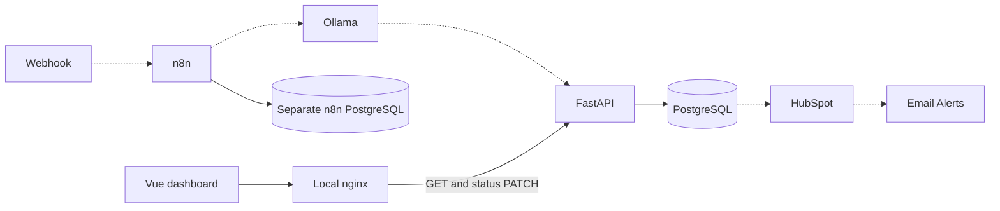

# Architecture and integration boundaries

## Target automation pipeline



The sequence is a logical business flow. n8n would orchestrate all model, API, CRM,
and alert calls. PostgreSQL has no trigger or client that sends to HubSpot; that
dashed edge means synchronization after persistence, through orchestration. The
Ollama→FastAPI edge represents n8n forwarding validated model output.

**Solid connections** are implemented by this repository. **Dashed connections**
are the target design and require a separately supplied and verified workflow.
Service availability does not establish that a model, workflow, CRM connection, or
email provider is configured. No workflow export or prompt is in this source tree.
Existing runtime workflows and credentials are left untouched.

## Implemented status update path

```mermaid
sequenceDiagram
    participant UI as Vue detail panel
    participant Proxy as Local nginx
    participant API as FastAPI
    participant DB as App PostgreSQL
    UI->>Proxy: PATCH status + expected_status
    Proxy->>API: PATCH /api/v1/inquiries/{id}/status
    API->>DB: SELECT current status
    API->>API: Validate expected state and transition
    API->>DB: UPDATE WHERE id AND current status
    alt One row updated
        API->>DB: COMMIT and refresh
        API-->>UI: Updated inquiry via proxy
        UI->>API: Refresh page and counts via proxy
    else Stale or forbidden state
        API-->>UI: 409; reload before retrying
    end
```

Rules are `new → in_progress → resolved`, plus `resolved → in_progress` for reopening.
Same-state requests are no-ops. The dashboard sends its observed status and never
optimistically claims success or automatically retries a write. Existing POST
clients and migrations remain compatible. These states already exist in the schema;
Phase 7 needs no migration. There is no status audit trail or modification timestamp.

## Classification and routing

The API accepts category sales/support/other, priority low/medium/high, and a nullable
summary. Missing category/summary remain null; missing priority defaults to medium.
Classification availability means fields are stored, not that a model invocation
succeeded. The record has no model, confidence, source, or processing-time metadata.

A future n8n workflow would validate Ollama's structured output, preserve the original
message, persist via FastAPI, and route by category: sales to CRM follow-up, support
to support handling, other to manual review. High priority could additionally trigger
an email alert. No prompt, urgency keyword rule, confidence threshold, alert SLA,
CRM mapping, or delivery guarantee is implemented here. These need explicit workflow
definitions, evaluations, retries, and idempotency before they can be claimed as working.

## Storage and security

App and n8n use separate PostgreSQL containers, credentials, private networks, and
persistent volumes. The API joins the app data network and the automation network;
n8n joins its own data network and automation. Ollama has persistent model storage.
Only the dashboard, API, and n8n publish host ports, all on `127.0.0.1`; PostgreSQL
and Ollama publish none. A public version needs actual identity/authorization, TLS,
authenticated automation calls, managed secrets, request limits, redacted audit logs,
tested backups, observability, and privacy/retention controls. Keep this version local.
